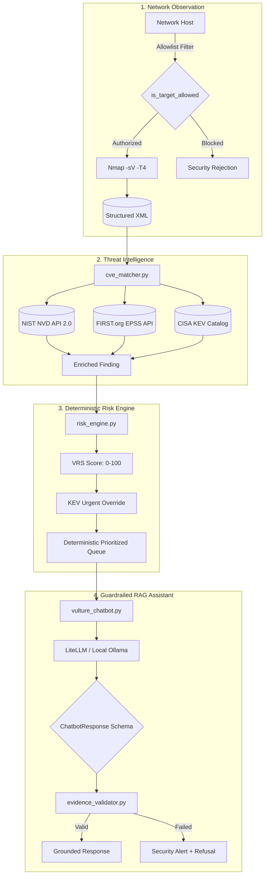

# Vulture-AI: Context-Aware Vulnerability Prioritization with Guardrailed RAG

[](https://github.com/damanknows/Vulture-AI/actions/workflows/tests.yml)
[](https://www.python.org/)
[](data/benchmark/cves.csv)
[](LICENSE)

An open, evidence-grounded vulnerability assessment and prioritization framework that couples real network observations with authoritative threat intelligence (NIST NVD, FIRST EPSS, CISA KEV) and a deterministic scoring heuristic: the **Vulture Risk Score (VRS)**. Quantitative prioritization is strictly decoupled from an accompanying Retrieval-Augmented Generation (RAG) assistant governed by Pydantic schemas and deterministic evidence validation.

---

## 1. Project Purpose and Scope

Enterprise security operations centers (SOCs) face overwhelming alert fatigue. Vulnerability backlogs routinely contain thousands of Common Vulnerabilities and Exposures (CVEs), yet standard remediation workflows rely almost exclusively on static severity metrics such as the Common Vulnerability Scoring System (CVSS) base score. CVSS measures theoretical technical impact under worst-case assumptions, omitting empirical exploitation telemetry and organization-specific network exposure.

**Vulture-AI** bridges this operational gap by:
1. Extracting service and version telemetry from network observation (Nmap XML).
2. Normalizing banners into Common Platform Enumeration (CPE 2.3) identifiers and enriching findings with NIST NVD v2.0, FIRST EPSS exploit probabilities, and CISA KEV active exploitation status.
3. Calculating the **Vulture Risk Score (VRS)**—a deterministic multi-factor priority score with a categorical override for confirmed in-the-wild exploitation.
4. Providing evidence-grounded, schema-constrained natural language remediation summaries that block prompt injections and numerical hallucinations.

---

## 2. Current Implementation Status

| Component | Status | Verification Detail |
|:---|:---:|:---|
| **Deterministic Risk Engine (`risk_engine.py`)** | Verified | Pure-Python scoring; handles missing CVSS, EPSS, and exposure via explicit fallback policies; deterministic tie-breaking. |
| **CVE Enrichment & Matching (`cve_matcher.py`)** | Verified | Self-contained CPE 2.3 formulation; disk-backed NVD/EPSS/KEV caching; separates confirmed from candidate matches. |
| **Evidence Validation Layer (`evidence_validator.py`)** | Verified | Intercepts indirect prompt injection patterns; verifies cited CVE IDs; enforces floating-point parity ($\pm 0.01$). |
| **RAG Assistant (`vulture_chatbot.py`)** | Verified | Enforces strict Pydantic JSON schema (`ChatbotResponse`); re-injects immutable VRS score directly from engine. |
| **Reproducibility Pipeline (`experiments/`)** | Verified | End-to-end reproducible runner (`reproduce_all.py`); automated metrics (NDCG@5/10/15, Spearman mid-ranks). |
| **REST API Server (`app.py`)** | Functional | Flask API with strict `VULTURE_ALLOWED_TARGETS` validation and CORS origin restrictions. |
| **Nmap Scanner (`scanner.py`)** | Functional | Synchronous subprocess execution with timeouts and XML parsing; lacks distributed celery queues. |
| **Frontend Web Dashboard (`static/`)** | Prototype | Static single-page dashboard serving scan results and chatbot queries. |

---

## 3. Research Questions and Proposed Contribution

This repository hosts the experimental artifacts and reference implementation for the double-blind IEEE conference submission to the **7th International Conference on Computing and Informatics (ICCI 2026)**:

* **RQ1 (Ranking Quality)**: How effectively does multi-factor risk scoring (VRS) prioritize emergency remediation actions compared to conventional single-metric baselines (CVSS-only, EPSS-only) and binary exploitation heuristics (KEV-first)?
* **RQ2 (Feature Sensitivity)**: What is the empirical marginal contribution of exploitation telemetry (EPSS, KEV) and environmental deployment context (exposure, asset criticality) to prioritization quality under proportional weight renormalization?
* **RQ3 (Evidence Grounding and Injection Resilience)**: Can a deterministic validation layer eliminate metric hallucinations and neutralize indirect prompt injections in network observation banners without degrading explanation utility?

---

## 4. Architecture Diagram



---

## 5. Features That Actually Work

* [x] **Strict Target Allowlist Enforcement**: Blocks unauthorized host scanning (`is_target_allowed`).
* [x] **Unprivileged Nmap Execution**: Executes version scans (`-sV`) safely with timeout guards.
* [x] **Self-Contained CPE Normalization**: Normalizes banner strings to CPE 2.3 without external project dependencies.
* [x] **Threat Intelligence Caching**: Queries NVD, EPSS, and KEV with disk-backed cache to respect rate limits.
* [x] **Pure Python Scoring**: Mathematical VRS computation independent of any external network service.
* [x] **Deterministic Tie-Breaking**: Breaks identical score ties via bucket tiers and primary CVE ID alphabetical order.
* [x] **Multi-Budget Metric Calculation**: Computes NDCG@5, NDCG@10, NDCG@15, and Spearman rank correlation with fractional mid-ranks.
* [x] **Indirect Prompt Injection Interception**: Detects adversarial jailbreaks embedded in retrieved service banners.
* [x] **Numerical Hallucination Prevention**: Validates floating-point severity claims against retrieved documents.

---

## 6. Installation

### Requirements
* Linux, macOS, or Windows WSL2
* Python 3.10+ (tested through 3.14)
* Nmap (optional, required only for live scanning; experiments run offline)

### Setup
```bash
git clone https://github.com/damanknows/Vulture-AI.git
cd Vulture-AI
python3 -m venv venv
source venv/bin/activate
pip install -r requirements.txt
```

---

## 7. Quick Start

### 1. Validate Benchmark Integrity
```bash
python generate_data.py
```

### 2. Run Offline Tests
```bash
pytest -v
```

### 3. Reproduce All Experimental Results
```bash
python experiments/reproduce_all.py
# Run CISA KEV enrichment on 41-record benchmark:
python experiments/enrich_benchmark_kev.py
# Run 500-CVE expanded benchmark generation & evaluation:
python experiments/generate_benchmark_500.py
```

### 4. Start Local Development Server
```bash
cp .env.example .env
export VULTURE_ALLOWED_TARGETS="127.0.0.1,localhost"
python app.py
```

---

## 8. Authorized Scanning Warning

> **CRITICAL LEGAL NOTICE**: Port scanning and service probing against IP addresses without explicit, documented authorization from the network owner is illegal under the Computer Fraud and Abuse Act (CFAA), UK Computer Misuse Act, and international equivalents.
>
> Vulture-AI implements a strict server-side allowlist (`VULTURE_ALLOWED_TARGETS`). Any attempt to probe unlisted hosts returns an immediate security rejection (`HTTP 403 Forbidden`).

---

## 9. Demo Mode versus Real Scanning

* **Demo / Benchmark Mode**: Evaluates prioritization heuristics offline using `data/benchmark/cves.csv` (39 real public CVEs + 2 synthetic missing-data edge-case records). Requires zero network access, zero Nmap privileges, and zero API keys.
* **Real Scanning Mode**: Initiated via `POST /api/scans`. Executes `nmap -sV` against authorized targets on localhost or internal test environments. Requires Nmap installed in the system PATH.

---

## 10. Risk-Score Formula and Feature Definitions

$$\text{VRS} = 100 \times \left( 0.25 \cdot C + 0.20 \cdot E + 0.20 \cdot K + 0.20 \cdot N + 0.15 \cdot A \right)$$

* **$C$ (Normalized CVSS)**: $\text{CVSS base score} / 10.0 \in [0.0, 1.0]$. Missing CVSS assigns `bucket = "unavailable"` and `vrs = None`.
* **$E$ (FIRST EPSS)**: Probability of exploitation within 30 days $\in [0.0, 1.0]$. Missing EPSS defaults to $0.0$ and flags an uncertainty.
* **$K$ (CISA KEV)**: $1.0$ if present in the Known Exploited Vulnerabilities catalog, else $0.0$.
* **$N$ (Network Exposure)**: $1.0$ (internet-facing perimeter), $0.7$ (DMZ/partner network), $0.3$ (internal subnet).
* **$A$ (Asset Criticality)**: $1.0$ (domain controller, payment gateway), $0.7$ (production database), $0.3$ (internal dev host).

**Urgent Bucket Policy**: If $K = 1.0$ (active KEV exploitation), the finding is placed into the `"urgent"` bucket, sorting ahead of unexploited findings regardless of continuous score.

---

## 11. Dataset Provenance and Limitations

The repository provides two benchmark tiers designed to evaluate prioritization heuristics across distinct experimental questions:

### 11.1 Original Reference Benchmark (41 Records, SSVC-Grounded)
The reference benchmark (`data/benchmark/cves.csv`, SHA-256: `27979cc0029e3d383dc4380c5ab991c4774d15539f5f3058f9ffb7f007416b5e`) contains **41 total records**:
* **39 Verified Public CVEs**: Sourced from NIST NVD, FIRST EPSS API, and CISA KEV (snapshot frozen 2026-10-14).
* **2 Synthetic Missing-Data Edge Cases**: `CVE-2024-99991` (missing CVSS) and `CVE-2024-99992` (missing EPSS) use non-existent identifiers to verify edge-case fallback logic.

**Author-Curated Reference Labels (Not Independent Ground Truth)**:
Reference priorities (1–41) and relevance grades (3=Act, 2=Attend, 1=Track, 0=Defer) are **author-curated reference labels based on a manual application of the CISA SSVC decision tree rubric**, NOT independently validated breach ground truth or analyst telemetry. Because SSVC triage relies on exploitation likelihood (KEV, EPSS) and exposure ($N$)—the same features evaluated by VRS—high ranking performance demonstrates **construct consistency / heuristic alignment with established triage principles**, not predictive proof of breach prevention. Independent analyst validation and breach-prediction telemetry are documented as future work. See [`docs/limitations.md`](docs/limitations.md) for full disclosure.

### 11.2 Expanded Research Benchmark (500 Real CVE Records, v2.0-500)
To stress-test prioritization dynamics across realistic enterprise vulnerability volumes, the repository includes an expanded corpus of **exactly 500 unique, real public CVEs**:
* **Base Dataset**: `data/benchmark/cves_500.csv` (SHA-256: `009c8566f1fdc4ed38b453deb351025019adac1942c5c5c2c52c822f856129ef`)
* **Enriched Dataset**: `data/benchmark/cves_500_enriched.csv` (SHA-256: `24dc74c14d4fd36ec3c3cd023cbd68072a454195ec37bacb368fe5955efe9517`)
* **Provenance Manifest**: `data/benchmark/cves_500_manifest.json`
* **Composition**: Preserves all 39 original real CVEs plus 461 real CVEs deterministically sampled (`seed=42`) from the official `CVEProject/cvelistV5` repository (release `cve_2026-10-13_2300Z`). Excludes synthetic records entirely (0 synthetic records).
* **Threat Telemetry**: Grounded with official CVE List V5 CVSS base scores, FIRST.org live EPSS queries, and the CISA KEV catalog (version `2026.10.13`). Exactly 25 of 500 records are confirmed in CISA KEV ($5.0\%$, matching real-world empirical exploitation rates).
* **Label Boundary**: The 461 new CVEs are explicitly marked `unlabeled`. No synthetic or heuristic SSVC labels are fabricated.

---

## 12. Benchmark Results

### 12.1 Primary Comparison at $K=10$ (41-Record SSVC Benchmark)
*Exact generated results from `experiments/results/metrics.json` against the 41-record benchmark:*

| Model | NDCG@10 | P@10 (Act) | R@10 (Act) | P@10 (Actionable) | R@10 (Actionable) | Spearman ($\rho$) |
|:---|:---:|:---:|:---:|:---:|:---:|:---:|
| **CVSS-only** | 0.7563 | 0.6000 | 0.4000 | 1.0000 | 0.3704 | 0.7357 |
| **EPSS-only** | 0.9217 | 0.8000 | 0.5333 | 1.0000 | 0.3704 | 0.8237 |
| **KEV-first** | 0.7945 | 0.7000 | 0.4667 | 1.0000 | 0.3704 | 0.8247 |
| **CVSS+EPSS+KEV** | 0.9513 | 0.9000 | 0.6000 | 1.0000 | 0.3704 | 0.8800 |
| **VRS Proposed (vrs-v1)** | **1.0000** | **1.0000** | **0.6667** | **1.0000** | **0.3704** | **0.9488** |

### 12.2 Multi-Budget Depth Sensitivity ($K \in \{5, 10, 15\}$)
| Model | NDCG@5 | NDCG@10 | NDCG@15 | Spearman ($\rho$) |
|:---|:---:|:---:|:---:|:---:|
| CVSS-only | 0.8062 | 0.7563 | 0.7855 | 0.7357 |
| EPSS-only | 1.0000 | 0.9217 | 0.8878 | 0.8237 |
| KEV-first | 0.8062 | 0.7945 | 0.8407 | 0.8247 |
| CVSS+EPSS+KEV | 0.9250 | 0.9513 | 0.9373 | 0.8800 |
| **VRS Proposed (vrs-v1)** | **1.0000** | **1.0000** | **1.0000** | **0.9488** |
| VRS (No EPSS) | 1.0000 | 1.0000 | 1.0000 | 0.9575 |
| VRS (No KEV) | 1.0000 | 0.9581 | 0.9675 | 0.9451 |
| VRS (No Context) | 0.9250 | 0.9513 | 0.9130 | 0.8782 |
| VRS (No Bucket Override) | 1.0000 | 1.0000 | 1.0000 | 0.9535 |

### 12.3 Retrospective CISA KEV Concordance Across 500 Real CVEs ($N_{\text{KEV}}=25$)
*Exact generated results from `experiments/results/expanded_500_table.md` across a 500-vulnerability backlog:*

| Prioritization Method | Precision@5 | Recall@5 | Precision@10 | Recall@10 | Precision@15 | Recall@15 | Precision@20 | Recall@20 | Precision@25 | Recall@25 |
|:---|:---:|:---:|:---:|:---:|:---:|:---:|:---:|:---:|:---:|:---:|
| **CVSS-only** | 1.0000 (5/5) | 0.2000 (5/25) | 0.7000 (7/10) | 0.2800 (7/25) | 0.7333 (11/15) | 0.4400 (11/25) | 0.5500 (11/20) | 0.4400 (11/25) | 0.4400 (11/25) | 0.4400 (11/25) |
| **EPSS-only** | 1.0000 (5/5) | 0.2000 (5/25) | 1.0000 (10/10) | 0.4000 (10/25) | 1.0000 (15/15) | 0.6000 (15/25) | 0.9500 (19/20) | 0.7600 (19/25) | 0.8800 (22/25) | 0.8800 (22/25) |
| **KEV-first** | 1.0000 (5/5) | 0.2000 (5/25) | 1.0000 (10/10) | 0.4000 (10/25) | 1.0000 (15/15) | 0.6000 (15/25) | 1.0000 (20/20) | 0.8000 (20/25) | 1.0000 (25/25) | 1.0000 (25/25) |
| **Combined Baseline** | 1.0000 (5/5) | 0.2000 (5/25) | 1.0000 (10/10) | 0.4000 (10/25) | 1.0000 (15/15) | 0.6000 (15/25) | 1.0000 (20/20) | 0.8000 (20/25) | 1.0000 (25/25) | 1.0000 (25/25) |
| **VRS Proposed (vrs-v1)** | 1.0000 (5/5) | 0.2000 (5/25) | 1.0000 (10/10) | 0.4000 (10/25) | 1.0000 (15/15) | 0.6000 (15/25) | 1.0000 (20/20) | 0.8000 (20/25) | 1.0000 (25/25) | 1.0000 (25/25) |

> **Key Empirical Finding**: In a 500-vulnerability backlog, **CVSS-only achieves only 44.0% recall at depth 25** (11/25 exploits captured), failing to prioritize 14 actively weaponized vulnerabilities. Threat-intelligence-aware scoring (**VRS Proposed**, **Combined Baseline**, and **KEV-first**) achieves **100% recall at depth 25** (25/25 exploits captured), surfacing all known exploited vulnerabilities in the first 25 positions.
>
> **Methodological Disclaimers**:
> 1. *Tied Performance*: VRS Proposed, Combined Baseline, and KEV-first achieve identical precision and recall for depths $K \le 25$ because all three prioritize KEV-listed items into the top tier. VRS does not claim superiority over EPSS-only or the Combined baseline at these cutoffs.
> 2. *Retrospective Check vs. Forward Prediction*: Ranking concordance is evaluated against the CISA KEV snapshot frozen on 2026-10-13, not forward predictive ability.
> 3. *Absence != Non-Exploitation*: Absence from CISA KEV indicates unobserved in federal civilian reporting, NOT confirmed non-exploitation.
> 4. *No Fabricated Labels*: The 461 newly sampled CVEs do not have manual SSVC labels. SSVC correlation metrics apply strictly to the 39 original labeled records.

---

## 13. Baseline and Ablation Methodology

* **Proportional Weight Renormalization Policy**: When component $i$ is removed, $w_i = 0$ and active weights are rescaled proportionally: $w_j' = w_j / \sum_{k \neq i} w_k$.
* **Ceiling Effects**: Because 15 records belong to Tier 1 (Act), any ordering of the top 10 positions containing only Tier 1 items achieves $\text{NDCG@10} = 1.0000$. Multi-budget evaluation at $K=15$ and Spearman correlation disambiguate these conditions.
* **EPSS Ablation Dynamics**: Removing EPSS increases Spearman correlation ($\rho = 0.9575$ vs. $0.9488$) because EPSS rewards high-volume automated reconnaissance bugs (e.g. OpenSSH user enum, EPSS 0.986) which SSVC classifies as *Defer*. Ablating EPSS allows CVSS impact and exposure to penalize these findings, aligning closer with the reference rubric.

---

## 14. Reproduction Instructions

To execute the complete reproduction pipeline in a single step:
```bash
python experiments/reproduce_all.py
# Or via Makefile:
make reproduce
```
Detailed environment versions, hash signatures, and configuration settings are saved to [`experiments/results/reproducibility_manifest.json`](experiments/results/reproducibility_manifest.json). See [`docs/reproducibility.md`](docs/reproducibility.md).

---

## 15. Tests and Known Limitations

* **Automated Tests**: 80 unit/benchmark tests pass cleanly (`pytest -v`). 1 integration test is skipped by default as it requires live root Nmap execution.
* **MockLLM Offline Fixture**: The RAG evaluation (`evaluate_rag.py`) uses a deterministic mock fixture to verify schema and guardrail behavior offline. Live red-teaming on commercial foundation models is planned for future work.
* **Sample Size**: While expanded to $N=500$ real CVEs with 25 active KEV exploits, comprehensive longitudinal evaluation across millions of software deployments remains ongoing.

---

## 16. Roadmap and Contribution Instructions

* [x] Pure-Python deterministic risk scoring engine
* [x] CISA SSVC-grounded benchmark with missing-data test cases
* [x] Deterministic multi-budget metric computation pipeline
* [x] Evidence validator and indirect prompt injection filter
* [x] IEEE conference paper draft (`paper/manuscript.pdf`)
* [ ] Asynchronous distributed worker queues (Celery/Redis)
* [ ] Vector database embedding integration for large vulnerability catalogs
* [ ] Longitudinal empirical SOC usability trials

See [`CONTRIBUTING.md`](CONTRIBUTING.md) for pull request guidelines.

---

## 17. Citation Instructions

If you use this benchmark dataset or scoring heuristic in your research, please cite:

```bibtex
@inproceedings{vulture_ai_2026,
  author    = {Anonymous Author(s)},
  title     = {Vulture-AI: Context-Aware Vulnerability Prioritization with Guardrailed Retrieval-Augmented Generation},
  booktitle = {Proceedings of the 7th International Conference on Computing and Informatics (ICCI 2026)},
  year      = {2026}
}
```
See [`CITATION.cff`](CITATION.cff) for machine-readable citation metadata.

---

## 18. License

This project is licensed under the Apache License 2.0. See the [`LICENSE`](LICENSE) file for the full license text.
