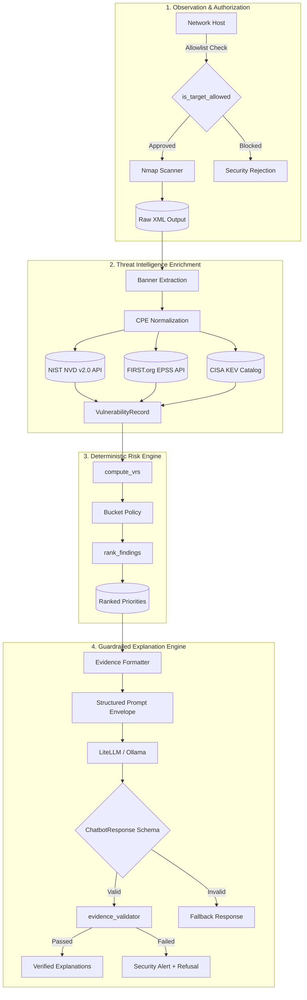

# Vulture-AI System Architecture

## Overview
Vulture-AI decouples quantitative vulnerability risk assessment from qualitative generative explanation. This architectural separation ensures that stochastic neural models cannot modify, estimate, or hallucinate numerical prioritization scores.

## Functional Modules

| Module | Location | Primary Responsibility |
|:---|:---|:---|
| **Scanner** | `scanner.py` | Enforces `VULTURE_ALLOWED_TARGETS` allowlist; executes `nmap -sV -T4` with timeout controls; parses XML findings. |
| **CVE Matcher** | `cve_matcher.py` | Normalizes service banners into CPE 2.3 identifiers; queries NVD with fallback to keyword matching. |
| **Threat Intel** | `threat_intel.py` | Queries FIRST EPSS API and CISA KEV JSON catalog; handles API errors and disk caching. |
| **Risk Engine** | `risk_engine.py` | Computes the deterministic Vulture Risk Score (VRS); applies KEV urgent bucket override and tie-breaking hierarchy. |
| **Retrieval** | `retrieval.py` | Indexes scan findings and threat intelligence; extracts evidence tuples with immutable `source_id` keys. |
| **Evidence Validator** | `evidence_validator.py` | Inspects explanations: detects prompt injection regexes, verifies cited CVE IDs, and enforces numeric float parity ($\pm 0.01$). |
| **Chatbot** | `vulture_chatbot.py` | Prompts local or hosted LLMs with strict Pydantic JSON schema constraints (`ChatbotResponse`). |
| **API Server** | `app.py` | Flask REST API serving scan initiation, findings queries, and chat endpoints with CORS restrictions. |
